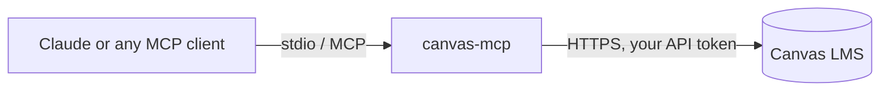

# canvas-mcp

[](https://github.com/anaylab/canvas-mcp/actions/workflows/ci.yml)
[](LICENSE)


Ask Claude about your coursework in plain language. **canvas-mcp** is an [MCP](https://modelcontextprotocol.io) server that connects AI assistants to your Canvas LMS account: courses, assignments, deadlines, grades, files, discussions and your inbox.

> **Unofficial.** Not affiliated with or endorsed by Instructure or Anthropic.

<p align="center"></p>

<sub>Illustrative, built from the demo data below. Your answers come from your own Canvas.</sub>

## Try it in a minute, no Canvas account needed

The repo ships a **demo mode**: a fake Canvas with realistic sample data (3 courses, upcoming and overdue work, grades, announcements, discussions, files and an inbox). It's the fastest way to see what this does.

```bash
git clone https://github.com/anaylab/canvas-mcp.git
cd canvas-mcp
npm install
npm run demo
```

It prints a ready-to-paste config block for Claude Desktop (**Settings → Developer → Edit Config**). Restart Claude Desktop and ask:

- "What's due this week?"
- "How am I doing in my classes?"
- "Summarise the late policy for CS301."
- "What did I miss in Algorithms?"

Writes (submitting, posting) are accepted in demo mode but nothing is stored.

## Use it with your real Canvas

Local stdio mode runs entirely on your machine. There is no server to host and no network exposure.

**Requirements:** Node.js 18+ and a Canvas account.

### 1. Create a Canvas API token

1. Log in to Canvas.
2. Go to **Account → Settings**.
3. Under **Approved Integrations**, click **+ New Access Token**.
4. Give it a purpose (for example "Claude MCP") and **set an expiry date**.
5. Copy the token. You can't view it again.

Some schools disable student tokens. If you don't see the option, ask your school.

### 2. Install and build

```bash
git clone https://github.com/anaylab/canvas-mcp.git
cd canvas-mcp
npm install
npm run build
```

### 3. Add it to Claude Desktop

Open **Settings → Developer → Edit Config** and add:

```json
{
  "mcpServers": {
    "canvas": {
      "command": "node",
      "args": ["/absolute/path/to/canvas-mcp/dist/index.js"],
      "env": {
        "CANVAS_API_TOKEN": "your_token",
        "CANVAS_BASE_URL": "https://yourschool.instructure.com"
      }
    }
  }
}
```

Restart Claude Desktop. Passing the token through `env` is more reliable than a `.env` file, because Claude Desktop starts the server from a different working directory.

Any other MCP client that supports stdio works the same way. You can also run `npm start` with a `.env` file (copy `.env.example`).

## What you can ask

| Say | Uses |
| --- | --- |
| "What's due in the next 5 days?" | `get_all_upcoming_work`, `get_todo` |
| "What am I missing or overdue on?" | `get_overdue_assignments` |
| "What's my grade in each class?" | `get_grades` |
| "What's the rubric for Problem Set 4?" | `get_assignment`, `get_rubric` |
| "Read the Week 6 lecture notes and summarise them" | `list_files`, `read_file` |
| "What does the syllabus say about late work?" | `get_course`, `list_pages`, `get_page` |
| "What did my professor announce this week?" | `list_announcements` |
| "Any unread messages from instructors?" | `list_inbox`, `get_conversation` |
| "What exams do I have this month?" | `list_calendar_events` |
| "Find everything about dynamic programming" | `search_course_content` |

### One-click prompts

MCP clients that support prompts show these as ready-made starting points:

| Prompt | What it does |
| --- | --- |
| `weekly_plan` | Day-by-day plan for the coming week from real deadlines |
| `whats_due` | Everything due soon, most urgent first |
| `grade_check` | Grade summary and where points are still available |
| `catch_up` | What you missed in a course while you were away |
| `assignment_brief` | Requirements, rubric and a plan for one assignment (it won't do the work for you) |

## Tools

| Area | Tools |
| --- | --- |
| Courses | `list_courses`, `get_course` |
| Grades and to-do | `get_grades`, `get_todo` |
| Assignments | `list_assignments`, `get_assignment`, `get_rubric` |
| Deadlines and search | `find_assignments_by_due_date`, `get_upcoming_assignments`, `get_overdue_assignments`, `get_all_upcoming_work`, `search_course_content`, `list_calendar_events`, `get_planner_items` |
| Course material | `list_modules`, `list_announcements`, `list_pages`, `get_page`, `list_files`, `read_file`, `list_quizzes`, `get_quiz` |
| Discussions | `list_discussions`, `get_discussion_entries`, `post_discussion_entry`, `reply_to_discussion` |
| Inbox | `list_inbox`, `get_conversation` |
| Submissions | `get_submission`, `submit_assignment`, `upload_file` |

Every tool carries MCP `readOnlyHint` / write annotations, so clients can auto-approve reads and always ask before writes.

**Writes:** `post_discussion_entry`, `reply_to_discussion`, `submit_assignment` and `upload_file` change data in Canvas as you. `upload_file` does **not** submit by default (`submit_after_upload: false`). Review what your assistant is about to do before approving those calls, and follow your school's academic integrity policy.

**Reliability:** all list endpoints follow Canvas pagination, requests time out after 30 s, and 429/5xx responses are retried with backoff (writes are never retried on 5xx, to avoid double-posting). Read responses are cached for 60 s (`CANVAS_CACHE_TTL_SECONDS`, `0` disables) and any write clears the cache.

## How it works



Your token stays on your machine (in the client config) and is only ever sent to your own Canvas host. Pagination links that point anywhere else are ignored.

## Troubleshooting

| Problem | Fix |
| --- | --- |
| "Missing required environment variables" | Put `CANVAS_API_TOKEN` and `CANVAS_BASE_URL` in the client config `env` block, not just in `.env` |
| `401` / "token is invalid or expired" | Create a new token in Canvas → Account → Settings |
| `403` on a tool | Your school or the course disabled that feature (for example the inbox or files) |
| No "New Access Token" button | Your school disabled student tokens; ask your Canvas admin |
| Tools don't appear in Claude Desktop | Use an absolute path to `dist/index.js`, run `npm run build`, then fully restart the app |
| `read_file` says "Not a text file" or "needs Node 22+" | Text files and PDFs are read (PDF text needs Node 22+; scanned PDFs have no text). Other binaries like slides return a download link |
| Data looks stale | Responses are cached for 60 s. Set `CANVAS_CACHE_TTL_SECONDS=0` to disable, or ask again in a minute |

## Host it in the cloud, free

Want to reach Canvas from a phone or a web-based MCP client? Deploy **your own** copy to a free tier. One deployment holds one person's token, so nobody has to trust anyone else with theirs.

[](https://render.com/deploy?repo=https://github.com/anaylab/canvas-mcp)

The [hosting guide](docs/HOSTING.md) covers Render and Google Cloud Run, how to connect Claude Code and other clients, and what the free tiers cost you (for example, Render sleeps when idle and takes about a minute to wake). `npm run start:http` serves `/mcp` and `/health`, and requires `Authorization: Bearer <MCP_AUTH_TOKEN>`.

**Limits to know about:** Claude Desktop and claude.ai connectors expect OAuth, which isn't supported yet, so use the local setup there. A shared instance for many people is intentionally not offered; see the guide for why. HTTP mode is not yet deployed-and-verified on a real host by the maintainers.

## Security

- Your Canvas token gives access to your account. Keep it out of git (`.env` is in `.gitignore`), give it an expiry, and revoke it from Canvas settings if it leaks.
- Treat your MCP client config file as a secret, since it contains the token.
- See [SECURITY.md](SECURITY.md) to report a vulnerability.

## Development

```bash
npm run dev     # TypeScript watch mode
npm run build   # compile to dist/
npm run demo    # fake Canvas + ready-to-paste client config
npm test        # build + unit, end-to-end, HTTP and demo-data tests
```

The test suite runs every tool against the demo data, so adding a tool means adding a route to `src/demo/fake-canvas.ts` and a line to `test/demo.test.mjs`. See [CONTRIBUTING.md](CONTRIBUTING.md).

## Roadmap

- OAuth for HTTP mode, so hosted connector UIs work
- Slide (PPTX) text extraction for `read_file`
- Instructor-side tools (grading queue, rubrics) behind an explicit opt-in

Ideas and PRs welcome.

## License

[MIT](LICENSE)
